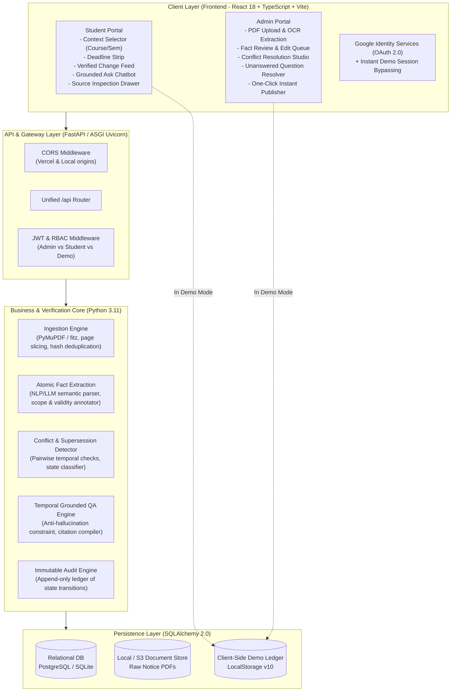
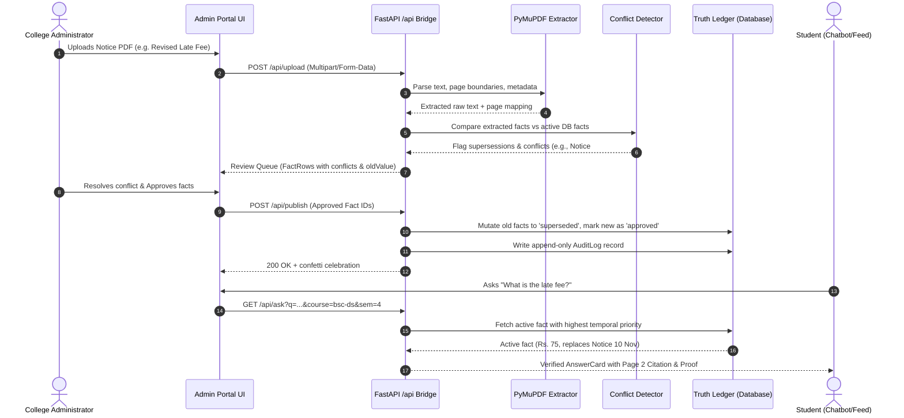
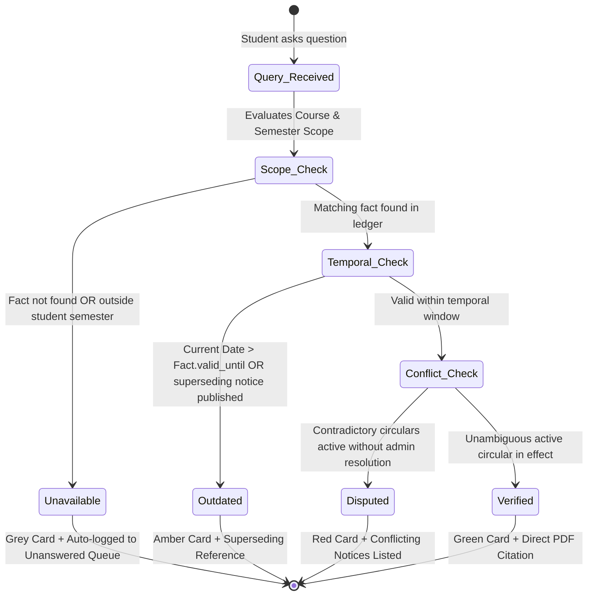
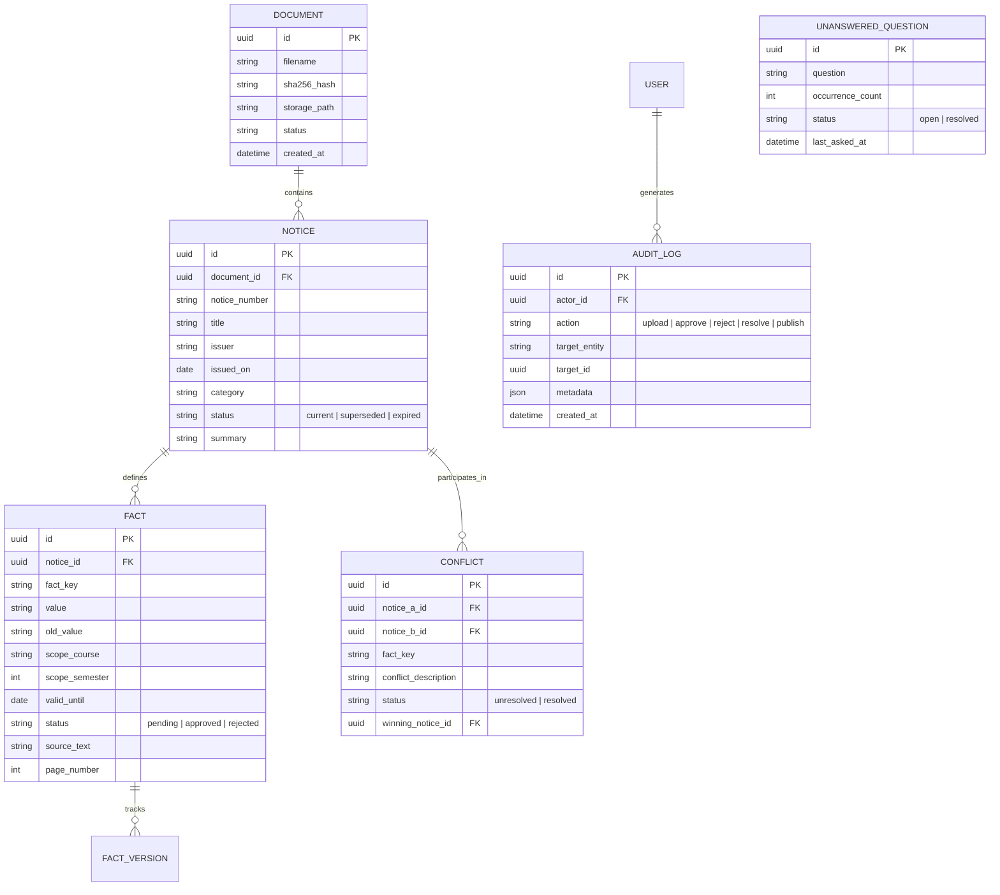

# Pramaan — Technical Architecture & System Specification

Pramaan is a **Deterministic Truth Ledger and Conflict-Resolution Engine** for educational institutions that digests unstructured administrative circulars (PDFs), extracts atomic facts, resolves inter-notice contradictions, and serves verified answers to students with page-level citations.

---

## 1. High-Level System Architecture

---

## 2. Ingestion & Truth Resolution Pipeline

---

## 3. Four Canonical Truth States

The core engine models every question into one of 4 deterministic states:

---

## 4. Database Schema (Entity-Relationship)

---

## 5. Technology Stack Summary

| Layer | Technologies | Role in System |
|---|---|---|
| **Frontend Framework** | React 18, TypeScript, Vite | Fast SPA bundling, strict type safety |
| **Styling & UI** | Tailwind CSS, Lucide React, Canvas Confetti | Responsive mobile-first interface, micro-interactions |
| **Client Persistence** | LocalStorage (`pramaan-demo-state-v10`) | Zero-backend demo operation for hackathons |
| **Backend Framework** | Python 3.11, FastAPI, Uvicorn (ASGI) | Async RESTful API, OpenAPI documentation |
| **Data Extraction** | PyMuPDF (`fitz`), Regex Lexers | Native PDF parsing, bounding box & page slicing |
| **ORM & Database** | SQLAlchemy 2.0, PostgreSQL / SQLite, Alembic | Type-annotated relational models & migrations |
| **Authentication** | Google Identity Services (GIS), JWT | Single Sign-On + Instant Role Switcher |
| **Deployment** | Vercel (Frontend), Render (FastAPI Docker/Web Service) | Global edge CDN + scalable cloud execution |
